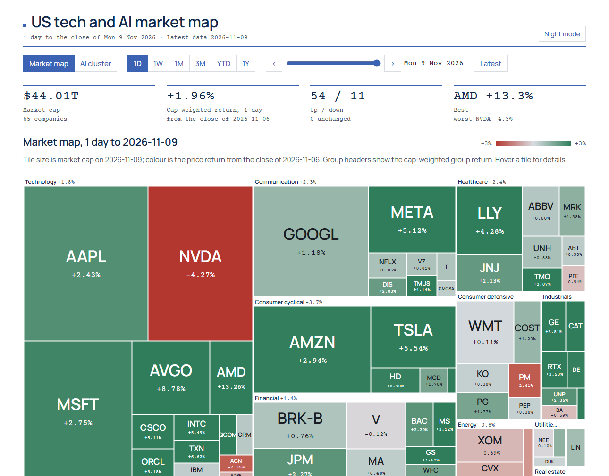
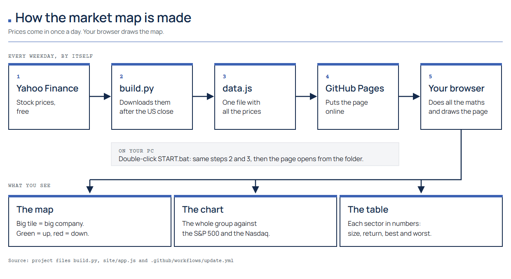
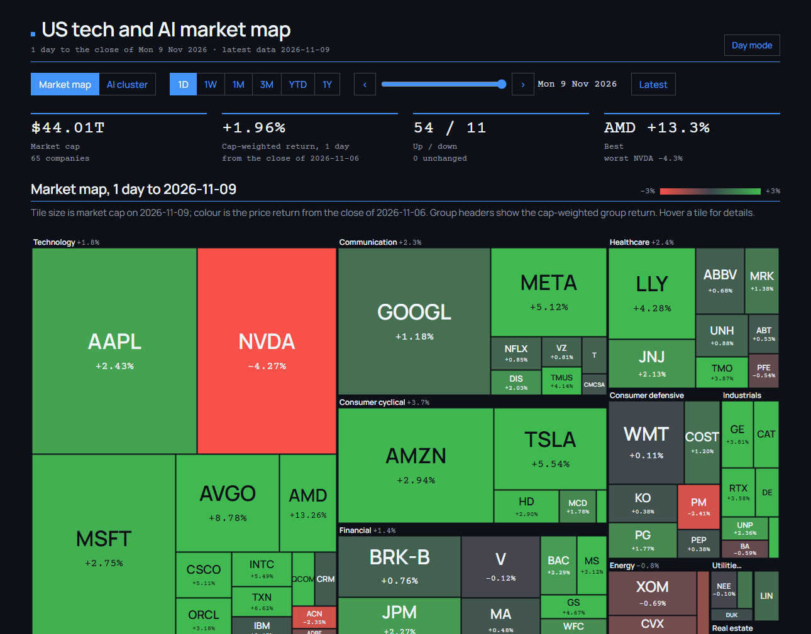
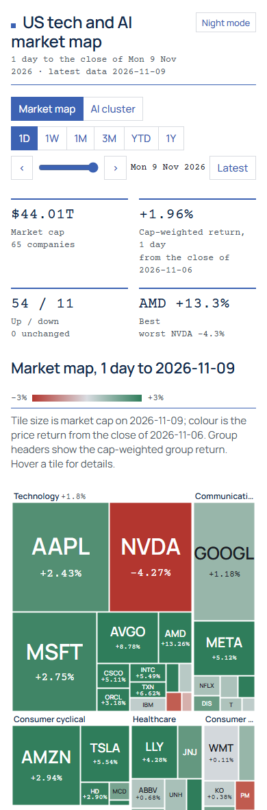

# How the AI stocks tracker is made

A look behind the US tech and AI market map: where the data comes from, how one small script
turns it into one file, and how the browser draws everything from that file.

- **Live page:** https://ai-stocks-tracker.github.io
- **Source code:** https://github.com/ai-stocks-tracker/ai-stocks-tracker.github.io

This repository holds only the explanation. The working code lives in the repository above.



## The idea in one paragraph

A heatmap of about 65 US large caps by sector, and a separate AI cluster of 33 companies in six
layers of the AI value chain. Tile size is market cap, colour is the return over the chosen
period. The design rule was to keep every moving part small: one Python script downloads prices
and writes **one data file**; the page is plain HTML, CSS and JavaScript that does **every
calculation in the browser**. There is no server, no database and no API key, so the same files
run on a laptop and on GitHub Pages.

## Data flow



In plain words:

1. **Yahoo Finance** has the stock prices, free.
2. **build.py** downloads them every weekday after the US close.
3. **data.js** is one file that holds all the prices.
4. **GitHub Pages** puts the page online.
5. **Your browser** does all the maths and draws the map, the chart and the table.

On a PC it is the same: `START.bat` runs steps 2 and 3, then the page opens from the folder.

The code below is shortened from the real files to show the idea; the full versions are in the
source repository.

## Step 1: download the prices

The tracked companies are three plain dictionaries at the top of `build.py`: groups of ticker
to display name. Changing what the map shows means editing these lines.

```python
MARKET = {
    "Technology": {"AAPL": "Apple", "MSFT": "Microsoft", "NVDA": "Nvidia", ...},
    "Communication": {"GOOGL": "Alphabet", "META": "Meta", ...},
    ...
}
AI = {
    "Chips & compute": {"NVDA": "Nvidia", "TSM": "TSMC", "AMD": "AMD", ...},
    "Power & cooling": {"GEV": "GE Vernova", "VRT": "Vertiv", ...},
    ...
}
BENCH = {"SPY": "S&P 500 (SPY)", "QQQ": "Nasdaq 100 (QQQ)", "SMH": "Semiconductors (SMH)", ...}
```

One call downloads every ticker at once; a small thread pool then asks for shares outstanding,
which give the market cap.

```python
px = yf.download(tickers, start="2024-12-31", interval="1d", auto_adjust=True,
                 progress=False, threads=True)["Close"]

with cf.ThreadPoolExecutor(max_workers=12) as pool:
    shares = dict(pool.map(shares_outstanding, tickers))
```

## Step 2: one data file

Everything the page needs goes into a single JavaScript file. Loading it with a `<script>` tag
(not `fetch`) is what lets the page open straight from disk with a double-click.

```js
window.DASH_DATA = {
  "built": "2026-11-10 15:04 UTC",
  "dates": ["2024-12-31", "2025-01-02", ...],          // one entry per trading day
  "tickers": {
    "AAPL": { "name": "Apple", "shares": 1.5e10, "close": [250.4, 243.3, ...] },
    ...
  },
  "bench": { "SPY": { "name": "S&P 500 (SPY)", "close": [...] }, ... },
  "universes": { "market": { "Technology": ["AAPL", "MSFT", ...] }, "ai": { ... } }
};
```

(Values shortened for the example.)

## Step 3: publish on a schedule

A GitHub Actions workflow runs the script after the US close and publishes the `site/` folder.
If the download fails, the step is allowed to fail and the prices already in the repository are
published instead, so the page never goes blank.

```yaml
on:
  schedule:
    - cron: "30 22 * * 1-5"   # 22:30 UTC, Monday to Friday
  workflow_dispatch: {}        # "Run workflow" button

jobs:
  build:
    steps:
      - run: pip install -r requirements.txt
      - run: python build.py
        continue-on-error: true
      - uses: actions/upload-pages-artifact@v4
        with: { path: site }
```

## Step 4: every number is computed in the browser

Returns come straight from two closes. The period buttons only change which two days are used.

```js
const ret = (t, a, b) => close(t, b) / close(t, a) - 1;   // a, b = indices of two trading days
const cap = (t, i) => close(t, i) * shares(t);           // market cap on day i
```

Group and basket returns are cap-weighted and buy-and-hold: the sum of the market caps at the
end divided by the sum at the start, counting only companies present on both days.

```js
function basketRet(tickers, a, b) {
  let c0 = 0, c1 = 0;
  for (const t of tickers) {
    const x = cap(t, a), y = cap(t, b);
    if (x != null && y != null) { c0 += x; c1 += y; }
  }
  return c0 ? c1 / c0 - 1 : null;
}
```

The treemap is d3's squarified layout: group, then company, with the area set to market cap and
the colour taken from a red-to-green scale that widens with the period (±3 % for one day, ±50 %
for one year).

```js
const root = d3.hierarchy({ children: groups }).sum((d) => d.value)   // value = market cap
  .sort((x, y) => y.value - x.value);
d3.treemap().size([W, H]).paddingTop(19).paddingInner(1)(root);

const colour = d3.scaleLinear().domain([-max, 0, max])
  .range([red, grey, green]).interpolate(d3.interpolateLab).clamp(true);
```

The date slider replays any trading day since January 2025 by moving the end index; nothing is
downloaded again.

## Design

The page follows a small personal design kit: navy titles with a blue square and a 1 px blue
rule, Manrope for text and Courier Prime for numbers and labels, sharp rectangles, booktabs
tables. Fonts and d3 are stored next to the page, so it makes no requests to other sites.

Night mode uses GitHub's dark palette. The page opens in day mode; the button in the header
switches and remembers the choice in the visitor's own browser.



On a phone the controls wrap, the map gets taller and the table scrolls sideways.



## Limits worth knowing

- **Data source.** Yahoo Finance through the unofficial `yfinance` library: free and keyless,
  but it can break when Yahoo changes its site, and its terms cover personal use.
- **Market caps are approximate.** They are today's shares outstanding times past closes, so past
  caps ignore buybacks and new shares. Fine for tile sizes and group totals, not a precise history.
- **Daily closes only.** No intraday prices; weekends and US holidays show the last trading day.
- **The schedule pauses itself.** GitHub stops scheduled workflows in a public repository after
  60 days without commits; one click in the Actions tab restarts it.

This is an educational project, not investment advice.

## License

Text, figures and code excerpts in this repository: MIT License, see `LICENSE`.
The tracker's own code and its bundled d3 and fonts are licensed in the source repository.
